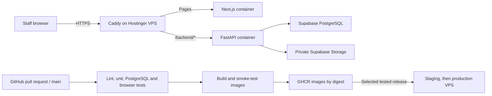

# Hostinger VPS deployment plan

Prepared 1 November 2026. This plan prepares deployment; it does not provision a
VPS, change DNS, migrate a hosted database, or publish the application.

## Decision

Run Caddy, the Next.js portal, and the FastAPI API on a Linux Hostinger VPS with
Docker Compose. Keep the existing managed Supabase database and private Storage.
Use GitHub-hosted runners to test and build images, and GHCR to retain them.
The VPS pulls images by digest rather than building from a live checkout.

Your existing Hostinger **KVM 2** has **Ubuntu 24.04 LTS, 2 vCPU, 8 GB RAM and
100 GB disk**. Use it for the initial deployment; no capacity upgrade is required
to start. Actual workload capacity still needs measurement. The current workflow
builds Linux/amd64 images and keeps compilation off the VPS.

No purchased domain is required for the initial setup. Use your existing hostname
**srv1878510.hstgr.cloud**, which resolved on 1 November 2026 to IPv4
`200.141.12.18` and IPv6 `2a02:4780:63:a71d::1`. DNS resolution was checked; VPS
ownership, port reachability and certificate issuance were not verified. Keep
ports 80/443 reachable for the published address families and let Caddy obtain a
public certificate. The environment templates now use this hostname.

For this single-VPS setup, run staging **before** production, with a separate
Supabase project, deployment root and Compose project name. Stop the staging
containers before starting production because both bind ports 80/443. This is an
initial rehearsal, not simultaneous environments. After production goes live, use
another machine for staging or explicitly redesign the shared proxy before running
both on one VPS. The setup guide includes the initial handover command.

## Ordered work

1. **Prepare the repository.** Review the existing uncommitted application work,
   commit the intended release including its Alembic revisions, and fix baseline
   lint/test failures. Protect `main` with required backend, web, and image jobs.
2. **Prepare isolated staging.** Select a separate Supabase project and private
   bucket, use synthetic or approved staging data, and choose a staging hostname.
   Never run destructive PostgreSQL fixtures against a hosted business database.
3. **Prepare the VPS.** Install Docker Engine and Compose 2.30+ with raw env-file
   support, configure SSH keys/firewall/DNS, and create the deployment directories.
   Follow the commands in README.md. Avoid a conflicting existing reverse proxy.
4. **Configure environments.** Keep application secrets only in server `app.env`.
   Create GitHub `staging` and `production` environments with their SSH settings.
   Authorize the VPS to pull the two private GHCR packages using a read-only token.
5. **Run CI.** Backend lint, all backend regression tests, an empty PostgreSQL
   migration rehearsal, local PostgreSQL race tests, frontend lint/unit/build/type
   checks, selected mocked and real browser workflows, and container/proxy checks.
   Publish images and a release artifact only after a successful push to `main`.
6. **Deploy staging.** Select the successful CI run in the deployment workflow.
   Pull its exact image digests, run migrations once, start the services, and check
   real DNS/TLS plus `/backend/ready` and `/login`.
7. **Verify real infrastructure.** Test login/logout, Excel/PDF uploads near the
   allowed size, source retrieval, procurement, packing, QR/sticker printing, and
   final invoices. Check real Supabase roles/pooler/Storage and concurrent staff
   edits. The disposable SQLite browser fixture does not establish hosted behavior.
8. **Rehearse operations.** Restore the database and source files to an isolated
   target, rehearse a compatible application rollback, configure external uptime
   and error alerts, and assign a maintenance/backup owner.
9. **Release production.** Record the migration/backup evidence and staff workflow
   acceptance, then deploy the **same CI run artifact** used in staging. Production
   selection is manual; the workflow does not automatically certify staging UAT.
10. **Operate.** Review failed jobs, disk/memory usage and alerts. Schedule host and
    image updates through staging. Retain previous release bundles and digests;
    do not prune them before the rollback retention period ends.

## Release behavior and limits

- API/Next.js ports are private; only Caddy publishes HTTP/HTTPS.
- Caddy routes `/backend/*` directly to FastAPI, keeping cookies on the app origin
  and avoiding a second upload proxy through Next.js.
- API and database migrations use the same image. Migrations run in one explicit
  process under a VPS deployment lock, never at every API restart.
- Database changes must remain compatible with the preceding app version during
  rollout. There is no automatic database downgrade or automatic data reseeding.
- Single-VPS Compose replacement can interrupt requests briefly. This is not a
  highly available or guaranteed zero-downtime deployment.
- Docker marks failing health checks but does not restart a running process merely
  because it is unhealthy. Process exits restart automatically; external monitoring
  must alert on a persistent readiness failure.
- VPS snapshots do not back up hosted Supabase data/files. Database and Storage
  backups and recovery evidence are separate release requirements.
- Keep payment/refund/receipt operations outside this release's current scope;
  the supported workflow ends at final invoice creation.

## Implementation and verification record

Deployment files and workflows are supplied in this change. Local verification
results and remaining checks are recorded in README.md. Existing application
changes are preserved; no hosted system has been contacted for mutation.
